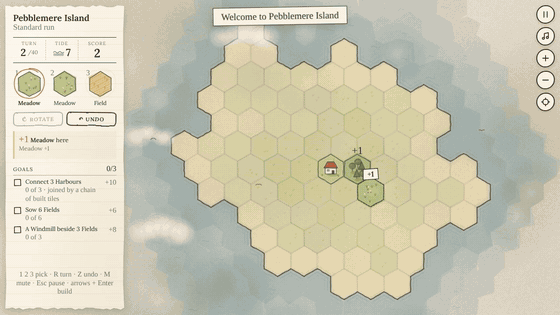
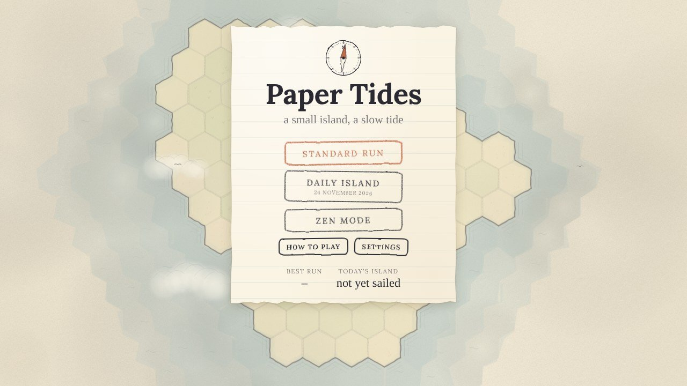
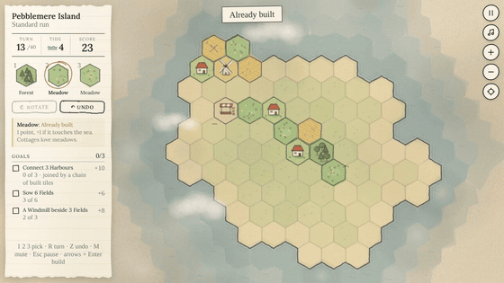
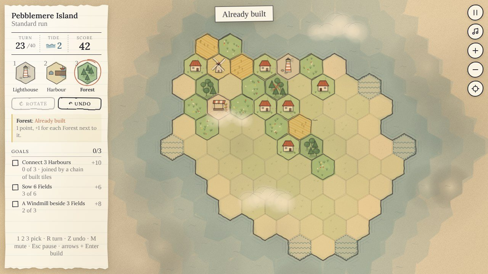
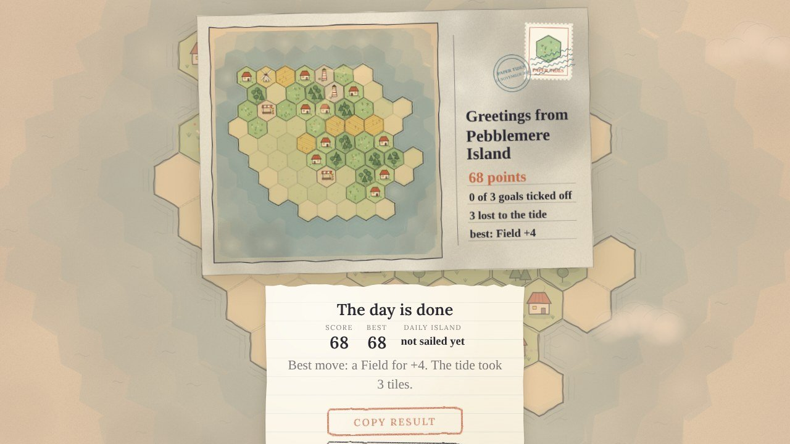

<div align="center">



# 🌊 Paper Tides 🌊

### *A little coastal village, drawn in ink and watercolour, one tile at a time.*

<a href="https://gorzawebk.github.io/Paper-Tides/"></a>


<sub>▲ A whole standard run, sped up, ending on its postcard. Recorded in the browser.</sub>

〰️ 〰️ 〰️ 〰️ 〰️ 〰️ 〰️ 〰️

</div>

A calm, turn-based hex-tile puzzle for the browser. Grow a little coastal village on an island drawn in ink and watercolour, one tile at a time, and keep it safe from the slowly rising tide.

Plays on PC (mouse and keyboard) and on phones and tablets (touch, portrait or landscape). There is no timer, ever: take as long as you like over every move. Everything in the game is made in code: the paper, the island, the tiles, the clouds and birds, the favicon, the sound effects and the music. The game itself loads no image or audio files (the pictures on this page are only screenshots).

## 🖼️ From the sketchbook

<table>
<tr><td align="center" valign="top"><br><sub>The title page</sub></td><td align="center" valign="top"><br><sub>Placing tiles, one turn at a time</sub></td></tr>
<tr><td align="center" valign="top"><br><sub>Halfway: the village takes shape</sub></td><td align="center" valign="top"><br><sub>The day is done: your postcard</sub></td></tr>
</table>

## ✍️ Controls

| Input | Action |
| --- | --- |
| Mouse over a hex | Preview the tile there and what it would score |
| Click | Place the tile |
| 1 / 2 / 3 | Pick one of the three tiles in the logbook |
| R (Shift+R) | Rotate the tile clockwise (anticlockwise) |
| Z | Undo the last placement (once per turn) |
| Arrow keys, then Enter or Space | Move a cursor across the hexes and build there |
| Mouse wheel, + / − | Zoom |
| Drag | Pan the map |
| M | Mute |
| Esc | Pause (and resume) |

**Touch:** tap a hex to preview the tile and its score, tap the same hex again to build. Drag with one finger to pan, pinch to zoom, or use the + / − buttons. The ⌖ button shows the whole island again. Tap a tile in the logbook to pick it, and use the Rotate and Undo buttons.

## 🏝️ How to play

Each turn the logbook offers **three tiles**. Place one on an empty hex of land; the other two stay, and a new tile is drawn into the empty slot. Hover (or tap) first to see exactly what a placement is worth: the tag over the hex shows the change to your island's score, and the logbook explains it.

A **standard run lasts 40 turns**. Over the run the day turns into evening, and at the end you get a postcard of your island.

### 🏠 Tiles and scoring

The island's score is the sum of every tile's score, worked out fresh from the board. So placing a tile can also raise its neighbours' scores, and the tide can wash points away.

| Tile | Scores |
| --- | --- |
| Meadow | 1, +1 if it touches the sea |
| Forest | 1, +1 for each Forest next to it |
| Field | 2 |
| Cottage | 1, +1 per Meadow and +2 per Market next to it. **Door** facing a Meadow or Market: +1 |
| Harbour | Must touch water. 2, +1 per Cottage or Market next to it. **Pier** facing water: +2 |
| Lighthouse | 1, +1 per water side (max 3). **Lamp** facing water: +1. Keeps the tide off the coast within 2 hexes |
| Windmill | 2 for each Field next to it |
| Market | 1 for each different kind of tile next to it. **Awning** facing a Cottage: +1 |

Tiles with a front (door, pier, lamp, awning) can be rotated; a dashed arrow on the preview shows which neighbour the front faces. Meadows, Forests, Fields and Windmills look the same whichever way round they go, so Rotate is greyed out for them.

### 🌊 The tide

After turns **8, 16, 24 and 32** the sea rises and floods the lowest coastal hexes that no Lighthouse is watching over: 3, then 4, 5 and 6 hexes. Flooded hexes become sea and whatever was built on them is lost, so the island changes shape and new coast appears inland. Two turns before each tide the hexes it will take ripple blue on the map, and the wave icon in the logbook fills up as the tide comes closer. Holding a Lighthouse shows its protection range before you place it, and the warning updates to show what it would save.

The land is drawn like a contour map: dashed lines separate ground of different heights, sandy hexes are low and grassy ones high. The coast is always lower than the middle of the island.

### 🎯 Goals

Each run picks three goals from a pool of eight (for example *Connect 3 Harbours*, *Build a village of 6 Cottages*, *Grow a wood of 5 Forests*, *A Windmill beside 3 Fields*). Reaching one ticks its box, rings a wind chime and adds its bonus, and the bonus is kept even if the tide later takes the tiles that earned it.

### 🗺️ Modes

- **Standard run:** a new random island and 40 turns.
- **Daily Island:** the same island, goals and tile draws for everyone on the same date. The seed is a hash of the date string (`YYYY-MM-DD`). Your first finished run of the day is your daily result; later runs that day are practice, though your best is kept too.
- **Zen mode:** no tide and no turn limit. You can also build on shallow water next to the shore to grow the island. Press **Finish island** in the logbook when you're done to get your postcard.

### ↩️ Undo

Z (or the Undo button) takes back your last placement, including any tide that followed it. You get one undo per turn: once you've undone a placement, the replacement you make that turn can't be undone again.

## 🎨 Visual style

- 2D only, drawn with Canvas 2D.
- **Paper:** a warm off-white sheet (`#f4ecd8`) made from soft mottling, a tiled grain texture, fibres, specks and a gentle vignette, all generated on start-up.
- **Watercolour:** every shape is filled several times at low opacity with its corners nudged outwards, so colour pools in the middle and bleeds a little past the ink line, with a darker dried edge. The sea is one compound path per pass, so it reads as one body of water with a deeper band along the coast.
- **Ink:** outlines are split into short wobbly strokes and drawn twice, like a dip pen going back over its line. The coastline gets two fading echo lines out to sea, like an old chart.
- **Palette:** cream paper `#f4ecd8`, ink `#2b2a33`, sea `#7fa7b5`, meadow `#a8c38a`, forest `#5f7f5a`, field `#e2c77a`, terracotta roofs `#c46a4a`.
- **Life:** tiles drop in like paper cut-outs with a small bounce and a shadow. Ripples drift slowly on the water, small ink birds flap across, and soft clouds drift over the map with their shadows.
- **Day to evening:** the paper warms through the afternoon and takes a dusky edge in the evening. Cottage and harbour windows light up, and lighthouse beams start to sweep near the end of the run.

## 🧭 UI

- **Type:** Fraunces (falling back to Lora, Georgia and serif) for a storybook feel; Caveat handwriting only for small notes, tags and the postcard.
- **Menus** are pages from a field journal: torn paper cards, ink-stamp buttons with rough, speckled edges, and a swaying compass on the main menu. Today's Daily Island is drawn behind the menu.
- **Logbook:** the in-game strip down the left side (along the bottom on phones held upright) holds the island's name, turns, a wave icon that fills as the tide approaches, the score, the three tile choices, Rotate and Undo, the score breakdown for the hovered hex and the goals with hand-drawn tick boxes.
- **End of run:** a watercolour postcard of the finished island with a stamp and postmark, your score, best and Daily Island result, and **Copy result**, which copies a short text with an emoji map of your island to share.
- **Settings:** sound and music volume, mute, reduce motion, colour-blind tile patterns (each tile type gets its own ink texture: dots, cross-hatch, diagonal lines, bricks, waves, rings, a big X and checks) and tile names on the map.
- **Tutorial:** five short illustrated steps the first time you play (skippable, and available again from the menu or Settings).

## 🎶 Sound

All synthesised with the Web Audio API:

- a soft paper *thup* when a tile lands, a paper swish when it turns and a pencil tick when you pick one
- wind-chime notes when a goal is completed, and a low bell with a swell of surf when the tide rises
- gentle waves (filtered brown noise that slowly swells)
- slow generative music: notes wandering over a D major pentatonic scale above a soft drone that changes chord every 14 seconds, with a generated reverb

## 🌐 Website and ads

- Two clearly marked, empty AdSense containers: `<div class="ad-slot" id="ad-menu">` on the main menu and `<div class="ad-slot" id="ad-gameover">` on the end screen. They live inside screens that are hidden during play, and `body.playing .ad-slot { display: none }` makes sure of it. Their height is reserved (728×90, or 320×100 on narrow screens) so nothing jumps whether or not an ad loads. Add `?ads=debug` to the URL to outline them.
- Best scores, daily results, settings and tutorial status are saved in `localStorage` (wrapped in try/catch, with an in-memory fallback).
- The page has a title, description, theme colour and Open Graph tags, and a favicon drawn in code (an inline SVG, replaced by a watercolour canvas version when the game loads).

## 🛠️ How it's built

- Plain JavaScript modules and [Vite](https://vite.dev). No framework and no runtime dependencies.
- The game rules (`game.js`, `scoring.js`, `tide.js`, `goals.js`, `board.js`) have no drawing or DOM code, so they run and are tested in Node.
- A seeded random number generator (mulberry32) drives the island, goals and tile draws, with separate streams so the Daily Island is the same for everyone. Its state is saved with each undo snapshot.
- **Performance:** the island is drawn once into an offscreen layer and only redrawn when the board changes or the zoom changes a lot. Each frame copies that layer and draws the few moving things on top, at about 30 fps for the slow ambient motion. With reduced motion on, nothing is drawn unless something changes. The layer is capped at 6 megapixels, and the device pixel ratio at 2.5.

| File | What it does |
| --- | --- |
| `src/main.js` | Start-up, screens, input handling and the flow of a run |
| `src/game.js` | One run: hand, turns, tide timing, goals, undo, modes |
| `src/board.js` | Hex grid of land and water, island generator, island names |
| `src/hex.js` | Axial hex maths: neighbours, distance, pixel conversion |
| `src/tiles.js` | Tile types, colours, weights and rules text, plus the palette |
| `src/scoring.js` | Adjacency scoring, placement rules and score previews |
| `src/tide.js` | Which coast floods next, Lighthouse protection |
| `src/goals.js` | The eight run goals and how progress is measured |
| `src/rng.js` | Seeded random numbers, date keys and the daily seed |
| `src/render.js` | Canvas renderer: camera, map layer, animations, evening light |
| `src/art.js` | Ink and watercolour drawing: paper, sea, coast, tiles, patterns, clouds, birds |
| `src/ui.js` | Logbook, toasts, torn edges, tutorial, postcard, share text, favicon |
| `src/input.js` | Mouse, touch, pinch and wheel on the map |
| `src/audio.js` | Synthesised sound effects, waves and generative music |
| `src/storage.js` | Settings, best scores, daily results (localStorage) |
| `src/style.css` | Journal pages, stamps, logbook and responsive layout |
| `tests/` | Node tests for scoring, the tide, the daily seed, undo and run length |

### 📝 Decisions made along the way

The brief left some details open; these are the choices made:

- **Rotation** matters for the four tiles with a front (door, pier, lamp, awning), each of which earns a bonus for facing the right neighbour. The other tiles have no front.
- **The hand** keeps the two tiles you didn't place; only the used slot is refilled. A hand of three identical tiles is never dealt.
- **The tide** rises four times, after turns 8, 16, 24 and 32, not after the last turn, so a run ends at evening rather than with a flood. Its warning shows during the two turns before each tide.
- **Every island starts with one Cottage** on its high ground, so there's something to build around.
- **Placement** is allowed on any empty land (Harbours must touch water). In Zen mode only, shallow water next to land can also be built on.
- **Score** is live, not banked: it's recalculated from the board each turn, so tides cost points. Goal bonuses are banked.
- **The Daily Island** uses the player's local calendar date, so everyone playing on "24 November" gets the same island. The first finished run of the day is the result; replays are allowed.
- **Touch** uses tap-to-preview, tap-again-to-build, because there is no hover on a touchscreen.

## 💻 Running locally

```bash
npm install
npm run dev        # dev server at http://localhost:5173 (also on your LAN for phone testing)
npm test           # scoring, tide, daily seed and undo tests
npm run build      # static site in dist/
npm run preview
```

Testing helpers: `window.paperTides` in the console gives you the current `game`, the `renderer`, `startRun(mode)` and `endRun()`.

## 🚀 Deployment

Every push to `main` runs the tests, builds the game and publishes it to GitHub Pages via `.github/workflows/deploy.yml`. One-time setup: in the repository's **Settings → Pages**, set **Source** to **GitHub Actions**.

---

<div align="center">

〰️ 〰️ 〰️ 〰️ 〰️ 〰️ 〰️ 〰️

*No timer. No rush. Just the tide, coming in.* 🕊️

</div>
